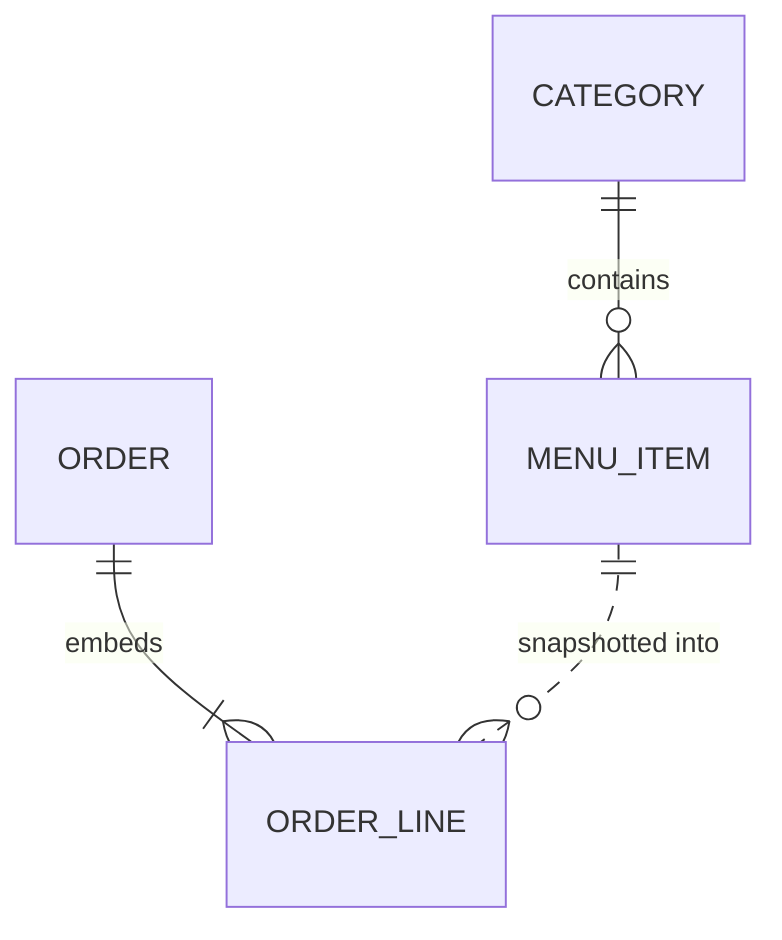

# Database

MongoDB 8 (Docker Compose), Mongoose 9. Database name `restaurant` (see `MONGO_URI`).
Schemas live in `apps/api/src/persistence/models/`; DTO mapping in `persistence/mappers.ts`.
API-level contracts are in `libs/shared/contracts`; money is always integer cents.

## `categories`

| Field                    | Type     | Notes                                                                  |
| ------------------------ | -------- | ---------------------------------------------------------------------- |
| `_id`                    | ObjectId |                                                                        |
| `name`                   | string   | 1–60 chars, trimmed                                                    |
| `nameKey`                | string   | lower-cased `name`; **unique** → case-insensitive duplicate protection |
| `sortOrder`              | number   | display order                                                          |
| `createdAt`, `updatedAt` | Date     |                                                                        |

Indexes: `nameKey` (unique), `sortOrder`.

## `menu_items`

| Field                    | Type           | Notes                                      |
| ------------------------ | -------------- | ------------------------------------------ |
| `_id`                    | ObjectId       |                                            |
| `categoryId`             | ObjectId       | → `categories._id`; checked in the service |
| `name`                   | string         | 1–100 chars                                |
| `description`            | string?        | up to 300 chars                            |
| `priceCents`             | number \| null | `1..1_000_000`; **null iff `openPrice`**   |
| `openPrice`              | boolean        | price is entered when added to an order    |
| `available`              | boolean        | default `true`                             |
| `sortOrder`              | number         | order inside the category                  |
| `createdAt`, `updatedAt` | Date           |                                            |

Indexes: `(categoryId, sortOrder)`, text index on `name`.

Invariant `openPrice ⇔ priceCents == null` is enforced three times: Zod discriminated union at the
edge, service logic when patching, and a Mongoose `pre('validate')` hook.

Deleting an item is a hard delete. Orders keep their own snapshot.

## `orders`

| Field                    | Type     | Notes                                                                          |
| ------------------------ | -------- | ------------------------------------------------------------------------------ |
| `_id`                    | ObjectId |                                                                                |
| `number`                 | number   | human-friendly sequence from `counters`; **unique**                            |
| `status`                 | enum     | `placed`, `preparing`, `ready`, `completed`, `cancelled`                       |
| `lines[]`                | embedded | `{ itemId, name, categoryName, unitPriceCents, quantity, openPrice }` snapshot |
| `subtotalCents`          | number   | sum of `unitPriceCents × quantity`                                             |
| `discountCents`          | number   | `0..subtotalCents`                                                             |
| `totalCents`             | number   | `subtotalCents − discountCents`                                                |
| `idempotencyKey`         | string   | from the `Idempotency-Key` header; **unique**                                  |
| `requestHash`            | string   | SHA-256 of the canonical request body                                          |
| `statusHistory[]`        | embedded | `{ status, at }`                                                               |
| `createdAt`, `updatedAt` | Date     |                                                                                |

Indexes: `idempotencyKey` (unique), `number` (unique), `(createdAt desc, _id desc)` for the cursor
pagination, `status`.

### Exactly-once order placement

The unique index on `idempotencyKey` is the guarantee. `POST /orders`:

1. looks the key up: same `requestHash` → replay the stored order, different hash → `422`;
2. otherwise validates the cart against the live menu and inserts;
3. when two requests with the same key race, one insert wins, the other gets a duplicate-key error
   (`E11000`), reads the winner and replays it.

Order statuses move only along the allowed transitions (`ORDER_STATUS_TRANSITIONS` in the
contracts). A transition is an atomic `findOneAndUpdate` filtered on the current status, so two
concurrent changes cannot both apply.

## `counters`

`{ _id: 'menuRevision' | 'orderNumber', seq }`. Incremented atomically with
`findOneAndUpdate({_id}, {$inc:{seq:1}}, {upsert:true})`.

- `menuRevision` – bumped on every menu mutation; returned by `GET /menu` and carried by menu
  events.
- `orderNumber` – the visible order number. A failed insert can leave a gap in the numbers; that
  is acceptable.

## Seed data

On startup with an empty database (`SEED_ON_EMPTY=true`) the API creates 12 categories and
`SEED_ITEM_COUNT` (default 3000) items with a deterministic generator (about 5 % unavailable,
3 % open-price). Run `npm run seed` to wipe the menu and recreate it. Orders are not touched by the
seed.

## Simplifications and production notes

- No transactions (standalone MongoDB). A menu write and its revision bump are two operations; a
  crash between them is repaired by the client's revision check. With a replica set, use a
  transaction.
- Idempotency keys never expire; production would keep them in a TTL collection (for example 24 h)
  separate from orders.
- No migrations tooling; indexes are created by Mongoose on start (`autoIndex`). Production should
  create them in a deploy step.
- No authentication or per-user data; every client sees every order.
