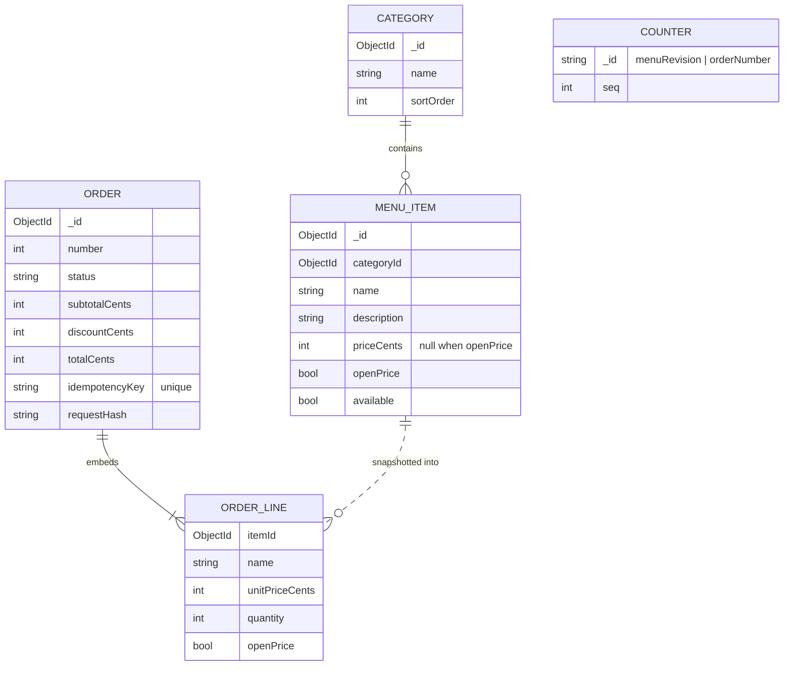
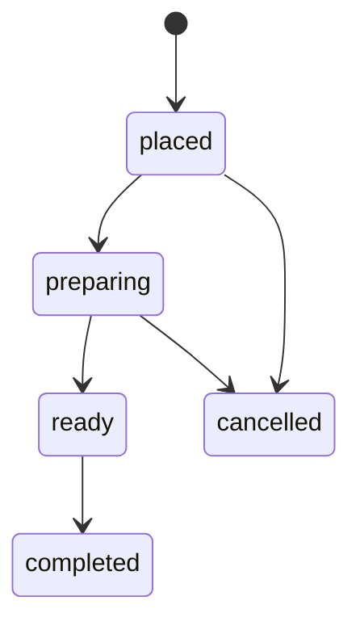
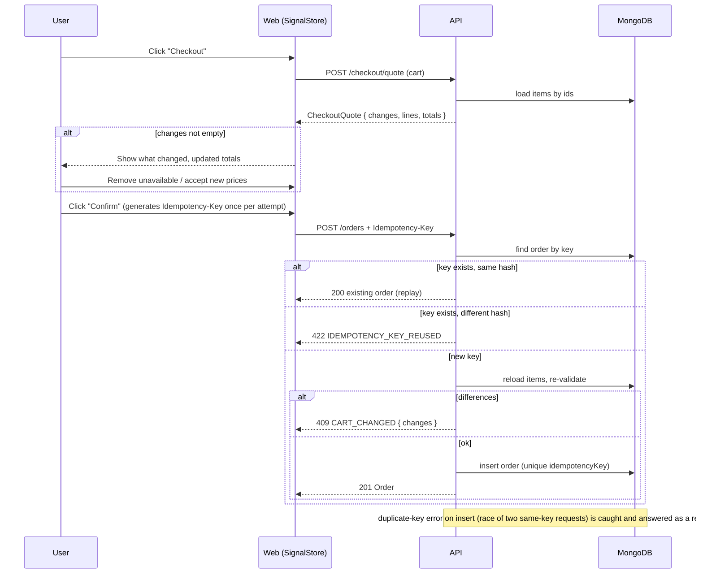

# Tech Design: contracts, data model, requests

Scope: the data contract between `apps/web` and `apps/api`, the MongoDB model and the HTTP/SSE
interface. The source of truth for every shape below is `libs/shared/contracts` (Zod). Types are
inferred from schemas (`z.infer`), OpenAPI is generated from the same schemas.

Status: draft for implementation. Items marked **(assumption)** are my calls where the assignment is
silent; they are repeated in the README decisions section.

---

## 1. Principles

| Topic         | Decision                                                                                  | Why                                                                       |
| ------------- | ----------------------------------------------------------------------------------------- | ------------------------------------------------------------------------- |
| Money         | Integer minor units (`...Cents`), currency is a single constant (`USD`) **(assumption)**  | No floating point errors; single currency keeps the prototype simple      |
| IDs           | `string` (Mongo ObjectId hex) in contracts; never `_id` / `ObjectId` leaks out            | Client stays independent of Mongo                                         |
| Time          | ISO 8601 UTC strings in contracts, `Date` in Mongo                                        | Serializable, sortable                                                    |
| Menu revision | One monotonically increasing integer `menuRevision`, bumped on **every** menu mutation    | Cheap consistency primitive for live updates, ETag and resync             |
| Snapshots     | Order lines store a snapshot of name and price at order time                              | Menu edits or deletions never rewrite history                             |
| Errors        | One error envelope with a stable machine `code`                                           | UI can map `code` to a message and a recovery action                      |
| Validation    | The same Zod schema validates the request on the server and drives the form on the client | One contract, no drift                                                    |
| Realtime      | Server → client over SSE, client → server over REST                                       | Flow is one-directional; SSE gives reconnect and `Last-Event-ID` for free |

---

## 2. Domain model



Collections: `categories`, `menu_items`, `orders`, `counters`. Order lines are embedded (always read
and written with the order, bounded size).

### 2.1 Rules

- A **category** has a unique (case-insensitive) name. It can be deleted only when it has no items
  (`409 CATEGORY_NOT_EMPTY`).
- A **menu item** belongs to exactly one category.
  - `openPrice = false` → `priceCents` is required, `0 < priceCents <= MAX_PRICE_CENTS`.
  - `openPrice = true` → `priceCents` is `null`; the price is entered when the item is added to
    the order.
  - Switching `openPrice` on clears `priceCents`; switching it off requires `priceCents`.
- **Availability** is a boolean. Out-of-stock quantity tracking is out of scope **(assumption)**.
- **Deleting an item** is a hard delete; orders keep their snapshot. A cart that still contains it
  gets `ITEM_REMOVED` at checkout validation.
- **Discount** is one fixed amount for the whole order: `0 <= discountCents <= subtotalCents`.
  `totalCents = subtotalCents - discountCents`.
- **Quantity** is an integer `1..99`. An order has `1..100` lines, one line per item
  (repeated adds merge on the client). Open-price items are the exception: the same item with a
  different price is a different line **(assumption)**, so lines are identified by
  `(itemId, unitPriceCents)`.
- **Open price** bounds: `1 <= unitPriceCents <= MAX_PRICE_CENTS` (`MAX_PRICE_CENTS = 1_000_000`).

### 2.2 Order status machine



- Transitions are validated on the server, invalid ones return `409 INVALID_STATUS_TRANSITION`.
- No kitchen UI in the assignment, so the API runs a **simulator**: every order advances
  `placed → preparing → ready → completed` on a timer (configurable, default 8 s per step).
  `PATCH /orders/:id/status` allows manual transitions and is what the simulator itself uses, so
  both paths emit the same event.

---

## 3. MongoDB schemas (Mongoose)

### 3.1 `categories`

| Field       | Type     | Notes                            |
| ----------- | -------- | -------------------------------- |
| `_id`       | ObjectId |                                  |
| `name`      | string   | 1..60, trimmed                   |
| `nameKey`   | string   | lower-cased `name`, unique index |
| `sortOrder` | int      | default: last                    |
| timestamps  | Date     | `createdAt`, `updatedAt`         |

Indexes: `{ nameKey: 1 } unique`, `{ sortOrder: 1 }`.

### 3.2 `menu_items`

| Field         | Type        | Notes                |
| ------------- | ----------- | -------------------- |
| `_id`         | ObjectId    |                      |
| `categoryId`  | ObjectId    | ref `categories`     |
| `name`        | string      | 1..100               |
| `description` | string      | 0..300, optional     |
| `priceCents`  | int \| null | null iff `openPrice` |
| `openPrice`   | boolean     |                      |
| `available`   | boolean     | default `true`       |
| `sortOrder`   | int         |                      |
| timestamps    | Date        |                      |

Indexes: `{ categoryId: 1, sortOrder: 1 }`, text index on `name` (server-side search fallback).
A Mongoose `pre('validate')` hook enforces the `openPrice` / `priceCents` invariant in addition to
the Zod check.

### 3.3 `orders`

| Field            | Type     | Notes                                                    |
| ---------------- | -------- | -------------------------------------------------------- |
| `_id`            | ObjectId |                                                          |
| `number`         | int      | human number from `counters`, unique                     |
| `status`         | enum     | `placed \| preparing \| ready \| completed \| cancelled` |
| `lines`          | array    | see below                                                |
| `subtotalCents`  | int      | sum of `unitPriceCents * quantity`                       |
| `discountCents`  | int      |                                                          |
| `totalCents`     | int      |                                                          |
| `idempotencyKey` | string   | from `Idempotency-Key` header, **unique index**          |
| `requestHash`    | string   | SHA-256 of the normalized request body                   |
| `statusHistory`  | array    | `{ status, at }`                                         |
| timestamps       | Date     |                                                          |

`lines[]`: `{ itemId, name, categoryName, unitPriceCents, quantity, openPrice }`.

Indexes: `{ idempotencyKey: 1 } unique`, `{ number: 1 } unique`, `{ createdAt: -1 }`.
A TTL is **not** set on `idempotencyKey` (orders are permanent); expiry of keys is a production
concern, see the README.

### 3.4 `counters`

`{ _id: 'menuRevision' | 'orderNumber', seq: int }`, incremented with
`findOneAndUpdate({ _id }, { $inc: { seq: 1 } }, { upsert: true, new: true })` – atomic.

### 3.5 Revision bump

Every menu mutation (category or item create / update / delete) does, in order:

1. apply the write;
2. `$inc` `menuRevision`;
3. publish an SSE event carrying that revision.

Not transactional (standalone Mongo, no replica set): if step 2 or 3 fails after step 1, the next
mutation or the client resync corrects the state. Accepted for the prototype.

---

## 4. Shared contracts (`libs/shared/contracts`)

Layout:

```
libs/shared/contracts/src/
  lib/
    common.ts      ids, money, pagination, error envelope
    menu.ts        category / item schemas
    checkout.ts    cart, validation result, create order
    orders.ts      order, status
    events.ts      SSE event union
    constants.ts   limits (MAX_PRICE_CENTS, MAX_QTY, ...)
  index.ts
```

### 4.1 Common

```ts
export const Id = z.string().regex(/^[a-f0-9]{24}$/);
export const Cents = z.number().int().nonnegative().max(MAX_ORDER_TOTAL_CENTS);
export const IsoDate = z.iso.datetime();

export const ErrorCode = z.enum([
  'VALIDATION_FAILED',
  'NOT_FOUND',
  'CATEGORY_NOT_EMPTY',
  'DUPLICATE_NAME',
  'CART_CHANGED', // checkout: availability / price differences
  'IDEMPOTENCY_KEY_REUSED', // same key, different payload
  'INVALID_STATUS_TRANSITION',
  'RATE_LIMITED',
  'INTERNAL',
]);

export const ApiError = z.object({
  error: z.object({
    code: ErrorCode,
    message: z.string(), // human readable, English
    details: z.unknown().optional(), // validation issues or CartChange[]
    requestId: z.string(),
  }),
});
```

### 4.2 Menu

```ts
export const Category = z.object({
  id: Id,
  name: z.string(),
  sortOrder: z.number().int(),
});
export const CategoryInput = z.object({ name: z.string().trim().min(1).max(60) });

const MenuItemBase = z.object({
  categoryId: Id,
  name: z.string().trim().min(1).max(100),
  description: z.string().trim().max(300).optional(),
  available: z.boolean().default(true),
});

// discriminated by openPrice so the invariant is part of the type
export const MenuItemInput = z.discriminatedUnion('openPrice', [
  MenuItemBase.extend({ openPrice: z.literal(false), priceCents: PriceCents }),
  MenuItemBase.extend({ openPrice: z.literal(true) }),
]);

// response shape: same union, plus server fields; priceCents is null for open-price items
export const MenuItem = z.discriminatedUnion('openPrice', [
  MenuItemBase.extend({
    id: Id,
    sortOrder: z.number().int(),
    openPrice: z.literal(false),
    priceCents: PriceCents,
  }),
  MenuItemBase.extend({
    id: Id,
    sortOrder: z.number().int(),
    openPrice: z.literal(true),
    priceCents: z.null(),
  }),
]);

export const MenuSnapshot = z.object({
  revision: z.number().int(),
  categories: z.array(Category),
  items: z.array(MenuItem),
});

export const MenuItemPatch = z.object({
  name: ..., description: ..., categoryId: ...,
  available: z.boolean(),
  openPrice: z.boolean(),
  priceCents: PriceCents.nullable(),
}).partial(); // cross-field rule re-checked after merge on the server
```

### 4.3 Checkout

```ts
export const CartLineInput = z.object({
  itemId: Id,
  quantity: z.number().int().min(1).max(MAX_QTY),
  // present iff the item is open-price (checked against the live item)
  unitPriceCents: PriceCents.optional(),
  // what the user saw when adding to cart; used to detect price changes
  expectedUnitPriceCents: PriceCents.optional(),
});

export const CheckoutRequest = z.object({
  lines: z.array(CartLineInput).min(1).max(MAX_LINES),
  discountCents: Cents.default(0),
});

export const CartChange = z.discriminatedUnion('type', [
  z.object({ type: z.literal('ITEM_UNAVAILABLE'), itemId: Id }),
  z.object({ type: z.literal('ITEM_REMOVED'), itemId: Id }),
  z.object({
    type: z.literal('PRICE_CHANGED'),
    itemId: Id,
    previousCents: PriceCents,
    currentCents: PriceCents,
  }),
  z.object({ type: z.literal('OPEN_PRICE_REQUIRED'), itemId: Id }),
  z.object({ type: z.literal('OPEN_PRICE_NOT_ALLOWED'), itemId: Id }),
  z.object({
    type: z.literal('DISCOUNT_TOO_HIGH'),
    maxCents: Cents,
  }),
]);

export const CheckoutQuote = z.object({
  menuRevision: z.number().int(),
  ok: z.boolean(), // true iff changes is empty
  changes: z.array(CartChange),
  lines: z.array(PricedLine), // resolved with current server prices
  subtotalCents: Cents,
  discountCents: Cents,
  totalCents: Cents,
});
```

### 4.4 Orders

```ts
export const OrderStatus = z.enum(['placed', 'preparing', 'ready', 'completed', 'cancelled']);

export const OrderLine = z.object({
  itemId: Id,
  name: z.string(),
  categoryName: z.string(),
  unitPriceCents: PriceCents,
  quantity: z.number().int(),
  openPrice: z.boolean(),
});

export const Order = z.object({
  id: Id,
  number: z.number().int(),
  status: OrderStatus,
  lines: z.array(OrderLine),
  subtotalCents: Cents,
  discountCents: Cents,
  totalCents: Cents,
  createdAt: IsoDate,
  updatedAt: IsoDate,
});

export const OrderStatusPatch = z.object({ status: OrderStatus });
export const OrdersPage = z.object({
  items: z.array(Order),
  nextCursor: z.string().nullable(),
});
```

### 4.5 Realtime events

```ts
export const ServerEvent = z.discriminatedUnion('type', [
  z.object({ type: z.literal('menu.category.upserted'), revision: z.number(), category: Category }),
  z.object({ type: z.literal('menu.category.deleted'), revision: z.number(), id: Id }),
  z.object({ type: z.literal('menu.item.upserted'), revision: z.number(), item: MenuItem }),
  z.object({ type: z.literal('menu.item.deleted'), revision: z.number(), id: Id }),
  z.object({ type: z.literal('order.created'), order: Order }),
  z.object({ type: z.literal('order.updated'), order: Order }),
]);
```

A published contract rule: availability and price changes are just `menu.item.upserted` events,
the client does not need separate event types.

---

## 5. HTTP API

Base path `/api`. JSON only. All error responses use the `ApiError` envelope. Every response has an
`X-Request-Id` header (generated if the client does not send one).

### 5.1 Endpoints

| Method | Path                     | Purpose                          | Request                    | Success                    |
| ------ | ------------------------ | -------------------------------- | -------------------------- | -------------------------- |
| GET    | `/health`                | Liveness + Mongo readiness       | –                          | `200 { status, mongo }`    |
| GET    | `/menu`                  | Full menu snapshot               | –                          | `200 MenuSnapshot`         |
| POST   | `/categories`            | Create category                  | `CategoryInput`            | `201 Category`             |
| PATCH  | `/categories/:id`        | Rename / reorder                 | `CategoryInput.partial`    | `200 Category`             |
| DELETE | `/categories/:id`        | Delete empty category            | –                          | `204`                      |
| POST   | `/items`                 | Create item                      | `MenuItemInput`            | `201 MenuItem`             |
| PATCH  | `/items/:id`             | Edit price / availability / etc. | `MenuItemPatch`            | `200 MenuItem`             |
| DELETE | `/items/:id`             | Delete item                      | –                          | `204`                      |
| POST   | `/checkout/quote`        | Validate cart, compute totals    | `CheckoutRequest`          | `200 CheckoutQuote`        |
| POST   | `/orders`                | Place order (idempotent)         | `CheckoutRequest` + header | `201 Order` / `200` replay |
| GET    | `/orders`                | List orders, newest first        | `?limit&cursor`            | `200 OrdersPage`           |
| GET    | `/orders/:id`            | One order                        | –                          | `200 Order`                |
| PATCH  | `/orders/:id/status`     | Manual status transition         | `OrderStatusPatch`         | `200 Order`                |
| GET    | `/events`                | SSE stream                       | `Last-Event-ID` header     | `text/event-stream`        |
| GET    | `/docs`, `/openapi.json` | Swagger UI and the spec          | –                          | –                          |

Notes:

- `PATCH` of an item or category returns the whole resource so the caller never needs a re-fetch.
- Menu write endpoints have no auth **(assumption)**; see README → production readiness.

### 5.2 `GET /menu` and the large menu

The ordering screen needs the whole menu to filter and search instantly and to react to live
patches, so the API returns **one snapshot** instead of paginating:

- Target size: 3 000–5 000 items (seed script). ~150 bytes per item gzipped → well below 1 MB raw,
  roughly 100 KB on the wire with `compression`.
- `ETag: "rev-<revision>"`; `If-None-Match` → `304`. Revisit and reload on reconnect is nearly free.
- The client renders with CDK virtual scroll, so DOM size does not grow with the menu.

Trade-off: it does not scale past tens of thousands of items. Production alternative: per-category
cursor pagination plus server-side search; documented in the README, not built.

### 5.3 Orders list

Cursor pagination on `(createdAt desc, _id desc)`: `GET /orders?limit=30&cursor=<opaque>`.
`nextCursor = null` ends the list. Live changes arrive over SSE and are merged into the same store.

### 5.4 Error mapping

| HTTP | `code`                      | When                                                            |
| ---- | --------------------------- | --------------------------------------------------------------- |
| 400  | `VALIDATION_FAILED`         | Zod failure; `details` holds issues with paths                  |
| 404  | `NOT_FOUND`                 | Unknown id                                                      |
| 409  | `DUPLICATE_NAME`            | Category name taken                                             |
| 409  | `CATEGORY_NOT_EMPTY`        | Deleting a category with items                                  |
| 409  | `CART_CHANGED`              | `POST /orders` found differences; `details` is a `CartChange[]` |
| 409  | `INVALID_STATUS_TRANSITION` | Illegal status move                                             |
| 422  | `IDEMPOTENCY_KEY_REUSED`    | Same key, different body                                        |
| 429  | `RATE_LIMITED`              | Optional basic limiter                                          |
| 500  | `INTERNAL`                  | Anything else; message is generic, details only in logs         |

`POST /checkout/quote` always answers `200` – differences are data (`changes`), not an error.
`POST /orders` answers `409 CART_CHANGED` when differences exist, because creating the order is
refused.

---

## 6. Checkout flow

Goal: never place an order twice and always tell the user about changes before confirming.



### 6.1 Server algorithm (`POST /orders`)

1. Validate headers and body. `Idempotency-Key` is required (`1..128` chars, `[A-Za-z0-9_-]`).
2. `requestHash = sha256(canonicalJson(body))`.
3. Look up the order by `idempotencyKey`:
   - found + same hash → return it with `200` and `Idempotency-Replayed: true`;
   - found + different hash → `422 IDEMPOTENCY_KEY_REUSED`.
4. Load all referenced items in one query. Build the quote with the **same function** used by
   `/checkout/quote` (`buildQuote(cart, items)`), so both endpoints can never disagree.
5. If `quote.changes` is not empty → `409 CART_CHANGED` with the changes. The client re-quotes.
6. Allocate `number` from `counters`, insert the order. A duplicate-key error on
   `idempotencyKey` means a parallel request won the race → read it and answer as in step 3.
7. Publish `order.created`; the simulator schedules the first status step.

### 6.2 Difference detection (`buildQuote`)

For every cart line, against the live item:

| Condition                                                   | Change                   |
| ----------------------------------------------------------- | ------------------------ |
| item missing                                                | `ITEM_REMOVED`           |
| `available = false`                                         | `ITEM_UNAVAILABLE`       |
| fixed price and `expectedUnitPriceCents != priceCents`      | `PRICE_CHANGED`          |
| `openPrice` and `unitPriceCents` missing                    | `OPEN_PRICE_REQUIRED`    |
| not `openPrice` and `unitPriceCents` sent                   | `OPEN_PRICE_NOT_ALLOWED` |
| `discountCents > subtotalCents` (computed over valid lines) | `DISCOUNT_TOO_HIGH`      |

The check is **per line, not per revision**: a menu edit unrelated to the cart does not block the
order. Prices in the quote always come from the server; the client never decides the total.

### 6.3 Client rules

- The idempotency key is created when the user opens the confirm step and **kept** across retries
  of the same attempt (network error, timeout). It is regenerated only after a `201`/`409`.
- "Confirm" is disabled while the request is in flight; the request is not auto-retried after a
  `409`, only after network errors/5xx with the same key.
- While the confirm dialog is open, live `menu.item.upserted` events re-run the quote, so the user
  sees a change even before pressing the button.

---

## 7. Realtime (SSE)

`GET /api/events` – `text/event-stream`.

```
id: 128
event: menu.item.upserted
data: {"type":"menu.item.upserted","revision":128,"item":{ ... }}

: heartbeat            ← comment every 20 s, keeps proxies from closing the connection
```

- **Event id** is a server-side monotonically increasing integer. The server keeps a ring buffer of
  the last N (default 500) events in memory.
- **Reconnect:** the browser's `EventSource` sends `Last-Event-ID`; the server replays the missed
  events from the buffer. If the id is older than the buffer, the server sends a
  `resync` event, and the client reloads `GET /menu` and the first page of orders.
- **Menu events carry `revision`.** The client applies an event only if
  `revision === localRevision + 1`; `revision <= localRevision` is ignored (duplicate); a gap
  triggers a resync. This keeps the client store correct even if the buffer logic has bugs.
- `order.*` events carry the whole order (small); the client upserts by id.
- Connection state is exposed in the store (`connecting | live | reconnecting | offline`) and
  rendered as a small banner. REST keeps working when SSE is down.

Where events come from: the service layer publishes to an in-process `EventBus` after a
successful write. MongoDB Change Streams would make this work across several API instances, but
need a replica set; documented as the production path.

---

## 8. Requests used by each screen

| Screen          | On open                | Actions                                                          | Live                                                |
| --------------- | ---------------------- | ---------------------------------------------------------------- | --------------------------------------------------- |
| Setup           | `GET /menu`            | category CRUD, item create / edit / delete, price + availability | `menu.*` events keep the table fresh (multi-tab)    |
| Menu (ordering) | `GET /menu` (ETag)     | add to cart (local), `POST /checkout/quote`, `POST /orders`      | `menu.item.*` update cards and the cart immediately |
| Orders          | `GET /orders?limit=30` | load more, optional manual status `PATCH`                        | `order.created` / `order.updated`                   |

Cart state lives only in the browser (SignalStore + `localStorage`), the server is not involved
until checkout.

---

## 9. Server structure

```
apps/api/src/
  main.ts                  bootstrap, graceful shutdown
  app.ts                   express app factory (testable with supertest)
  config/env.ts            Zod-validated environment
  http/
    middleware/            request-id, logger (pino-http), validate(zod), error-handler
    routes/                menu.routes, checkout.routes, orders.routes, events.routes, docs.routes
  domain/
    quote.ts               buildQuote – pure, unit-tested
    order-status.ts        transition table
    money.ts
  persistence/
    models/                category.model, menu-item.model, order.model, counter.model
    repositories/
  realtime/
    event-bus.ts           publish + ring buffer
    sse.controller.ts
  simulator/order-simulator.ts
  openapi/registry.ts      zod-to-openapi registration, builds /openapi.json
  seed/seed.ts             3–5k items for the large-menu scenario
```

Rule: routes only parse, call a service and map results; business rules live in `domain/` and are
tested without Express or Mongo.

---

## 10. Documentation deliverables

| File / URL               | Content                                                              | How it is produced                    |
| ------------------------ | -------------------------------------------------------------------- | ------------------------------------- |
| `/docs`, `/openapi.json` | REST API reference with schemas, examples and error codes            | generated from the Zod contracts      |
| `docs/realtime.md`       | SSE protocol: event list, ids, replay, resync, revision rules        | written (OpenAPI cannot describe it)  |
| `docs/database.md`       | Collections, fields, indexes, invariants, ER diagram                 | written from section 2–3 of this file |
| `docs/tech-design.md`    | This document                                                        | –                                     |
| `README.md`              | Run, decisions and trade-offs, simplifications, production readiness | written at the end                    |

---

## 11. Test plan (contracts and requests)

- **Contracts:** schema tests for the `openPrice` invariant, limits, discriminated unions.
- **Domain (`quote.ts`):** table-driven tests for every `CartChange` plus discount edge cases
  (`discount == subtotal`, `discount > subtotal`, no valid lines).
- **API (supertest + mongodb-memory-server):**
  - category / item CRUD and invariants, `CATEGORY_NOT_EMPTY`;
  - `POST /orders` happy path, `CART_CHANGED`, replay with the same key, `IDEMPOTENCY_KEY_REUSED`;
  - concurrent `POST /orders` with the same key creates exactly one order;
  - status transitions, SSE replay by `Last-Event-ID`.
- **Web:** store tests for revision gap handling, optimistic cart, checkout state machine.

---

## 12. Open questions

1. Currency and formatting: fixed `USD` with `Intl.NumberFormat`, or configurable? (default: fixed)
2. Should "cancel order" be exposed in the UI? (default: API only)
3. Is a hard delete of items acceptable, or should deleted items stay as archived? (default: hard
   delete, history is safe thanks to snapshots)
4. Do we need per-item stock quantity? (default: no, boolean availability)
