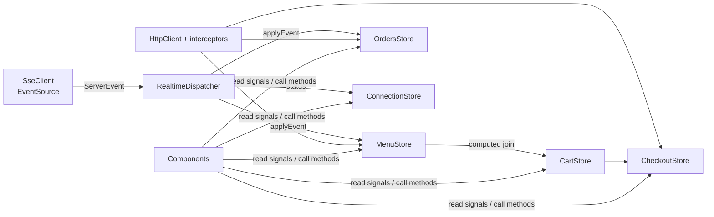
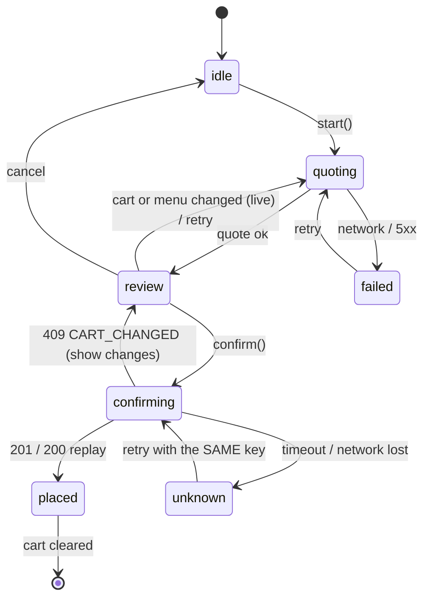

# UI Tech Design (`apps/web`)

Companion to [tech-design.md](./tech-design.md). This document covers the Angular application:
structure, state, data flow, screens, performance and error handling. API shapes, events and error
codes are defined there and imported from `@restaurant/contracts`.

Stack: Angular 22 (zoneless, standalone, signals) · Angular Material + CDK · NgRx SignalStore
(`@ngrx/signals`) · Jest · SCSS.

---

## 1. Principles

| Topic            | Decision                                                                                                     | Why                                                                                  |
| ---------------- | ------------------------------------------------------------------------------------------------------------ | ------------------------------------------------------------------------------------ |
| Change detection | Zoneless, `OnPush` everywhere, state in signals                                                              | Least work per update, matches low-end device requirement                            |
| State            | One SignalStore per concern; components only read signals and call store methods                             | Components stay dumb and trivially testable                                          |
| Server state     | Normalized in stores (`withEntities`), updated by HTTP responses **and** SSE events through the same methods | One code path, live updates cannot diverge from fetched data                         |
| Derived data     | `computed` joins (cart ⨝ menu), never copies                                                                 | Price / availability change in the menu reflects in the cart instantly               |
| Forms            | Reactive Forms (stable) + Zod validators from `@restaurant/contracts`                                        | Signal Forms are still experimental; the Zod schema stays the single source of rules |
| Money            | Integer cents in state, formatted only in a `money` pipe                                                     | Matches the API contract                                                             |
| Routing          | Lazy routes per feature; `@defer` for heavy UI (dialogs, cart panel)                                         | Small initial bundle                                                                 |
| Styling          | Material 3 theme + a few SCSS tokens, no extra UI libraries                                                  | Fits the assignment's stack, fewer bytes                                             |

---

## 2. Workspace structure

Nx libraries by layer (enforced by tags in `eslint.config.mjs`), and **inside each library a flat
structure by feature**: one folder per feature or sub-feature, role-named files, no deeper nesting.

```
apps/web/src/app/                 shell: config, routes, realtime wiring, toolbar, banner
libs/web/
  core/                           cross-cutting infrastructure
    errors/  http/  connection/  realtime/  notifications/
    store/                        reusable SignalStore features: withRequestStatus, withStorageSync
  ui/                             presentational components, pipes, validators (no stores, no HTTP)
  menu-data-access/               menu domain data
    menu.api.ts  menu.state.ts  menu.store.ts  menu.commands.ts  menu.cache.ts  menu.testing.ts
  orders-data-access/             orders domain data
    orders.api.ts  orders.state.ts  orders.store.ts
  feature-ordering/               catalog + cart + checkout
    catalog/   catalog.page, catalog-filters.component
    cart/      cart.state, cart.view, cart.store, cart-panel.component, quantity-stepper, open-price.dialog
    checkout/  checkout.state, checkout.store, checkout.dialog
  feature-setup/                  menu configuration
    setup.page
    categories/  category-list.component, category-name.dialog
    items/       item-list.component, item-form.dialog
  feature-orders/                 orders list
    orders.page, order-detail.component
libs/shared/contracts             Zod schemas and types shared with the API
```

File roles (same idea as the server's `router/controller/service/repository/entity`):

| Suffix           | Role                                                                          |
| ---------------- | ----------------------------------------------------------------------------- |
| `*.page.ts`      | Routed screen: layout and screen states (loading / error / empty), no logic   |
| `*.component.ts` | Reusable piece of a screen; inputs/outputs, injects stores it needs           |
| `*.dialog.ts`    | Dialog opened with `MatDialog`; loaded lazily with a dynamic `import()`       |
| `*.store.ts`     | NgRx SignalStore: the only place that holds and changes feature state         |
| `*.state.ts`     | State type, initial state, constants (and pure state helpers such as restore) |
| `*.view.ts`      | Pure functions that derive view data (testable without Angular)               |
| `*.commands.ts`  | Write operations of a store, built against a small port (see §4)              |
| `*.api.ts`       | `HttpClient` wrapper for one backend area                                     |

Tags and rules:

| Tag                | May depend on                                              |
| ------------------ | ---------------------------------------------------------- |
| `type:feature`     | `type:data-access`, `type:ui`, `type:core`, `scope:shared` |
| `type:data-access` | `type:core`, `scope:shared`                                |
| `type:ui`          | `scope:shared` only (no stores, no HTTP)                   |
| `type:core`        | `scope:shared`                                             |
| `type:app`         | everything in `scope:web`                                  |

Features never import each other. `feature-ordering` needs the menu data → it imports
`menu-data-access`, not `feature-setup`.

---

## 3. Routing and shell

| Path      | Feature            | Notes                     |
| --------- | ------------------ | ------------------------- |
| `/`       | redirect → `/menu` |                           |
| `/menu`   | `feature-ordering` | catalog + cart + checkout |
| `/orders` | `feature-orders`   |                           |
| `/setup`  | `feature-setup`    |                           |
| `**`      | not found page     |                           |

All feature routes use `loadComponent` / `loadChildren`. The shell is a toolbar with three nav
links (Menu, Orders, Setup), a cart badge (visible on `/menu`) and the connection indicator.
Router uses `withComponentInputBinding()`, so the category filter lives in the URL
(`/menu?category=<id>&q=pizza`) and survives refresh and sharing.

Preloading: `PreloadAllModules` is **not** used; after first render the idle preloader fetches
`/orders` and `/setup` chunks (`requestIdleCallback`) to keep initial JS small yet navigation fast.

---

## 4. State (NgRx SignalStore)



### 4.1 `ConnectionStore` (core)

| State         | Type                                                    |
| ------------- | ------------------------------------------------------- |
| `sse`         | `'connecting' \| 'live' \| 'reconnecting' \| 'offline'` |
| `online`      | `boolean` from `navigator.onLine` events                |
| `lastEventAt` | `number \| null`                                        |

Computed `health`: `ok` (live) · `degraded` (reconnecting) · `offline`. Drives the banner.

### 4.2 `MenuStore` (menu-data-access)

```ts
withState({
  revision: 0,
  status: 'idle' | 'loading' | 'ready' | 'error',
  error: ApiErrorView | null,
});
withEntities<Category>({ collection: 'category' });
withEntities<MenuItem>({ collection: 'item' });
withComputed: (categoriesSorted, itemsByCategory(Map), itemById(Map), isEmpty);
withMethods: load(); // GET /menu, ETag aware; sets revision
applyEvent(e); // revision rule below
createCategory / renameCategory / deleteCategory;
createItem / updateItem / deleteItem; // setup screen
```

**Revision rule** (mirrors the server contract):

```
event.revision === revision + 1  → apply, revision = event.revision
event.revision  <= revision       → ignore (duplicate / replay)
event.revision  >  revision + 1   → gap → load() (full resync)
```

Mutations from this client are applied from the HTTP response through the same `applyEvent`-style
upsert, so the later SSE echo of the same change is a harmless duplicate (ignored by revision).

Optimistic updates: the **availability toggle** in Setup flips immediately and rolls back with a
snackbar on failure (cheap, high-frequency action). All other setup writes wait for the server
(price edits, deletes), because validation can legitimately reject them.

### 4.3 `CartStore` (feature-ordering)

State holds only user intent; names and prices are never copied:

```ts
type CartLine = {
  itemId: string;
  quantity: number; // 1..99
  unitPriceCents?: number; // only for open-price items
  seenPriceCents?: number; // price the user saw → expectedUnitPriceCents on checkout
};
```

Computed `lines` joins with `MenuStore.itemById`:

```ts
interface CartLineView {
  line: CartLine;
  item: MenuItem | null; // null → removed from menu
  status: 'ok' | 'unavailable' | 'removed' | 'price-changed';
  unitPriceCents: number | null;
  lineTotalCents: number;
}
```

- `subtotalCents` sums only `ok` and `price-changed` lines; unavailable / removed lines are shown
  struck-through and excluded, with a "Remove" action.
- `discountCents` is a signal; computed `discountError` when above the subtotal; `totalCents`.
- Persisted to `localStorage` (`effect` with debounce, schema-validated on read; corrupt data is
  dropped silently). Never persists menu data.
- A `price-changed` status appears when a fixed price differs from `seenPriceCents`; the line shows
  old → new price and the cart header shows a notice. `acknowledgePrices()` copies the current
  prices to `seenPriceCents`.
- Merging rule: adding the same fixed-price item increments quantity; for open-price items a line is
  `(itemId, unitPriceCents)`.

### 4.4 `CheckoutStore` (feature-ordering)

Explicit state machine, so impossible UI states are unrepresentable:



- `idempotencyKey` is generated (`crypto.randomUUID()`) when entering `review` and kept until
  `placed` or `idle`. Retries from `unknown` reuse it, which makes a double charge impossible.
- `confirm()` is a no-op unless `state === 'review'` (guards double click) and the button is
  disabled while `confirming`.
- While in `review`, a menu change (SSE) re-runs the quote (debounced 300 ms) and the dialog
  updates in place with a "Menu changed" highlight, so the user sees changes before confirming.
- The quote is always the source of the numbers shown in the dialog (server prices), not the cart's
  local computation.
- On `placed`: clear cart, show confirmation with order number and a link to `/orders`.

### 4.5 `OrdersStore` (orders-data-access)

`withEntities<Order>`, `nextCursor`, `status`, computed `sorted` (newest first). Methods:
`loadFirstPage()`, `loadMore()`, `applyEvent()`. `order.created/updated` upsert by id. On SSE
resync the first page is reloaded and merged. Also sets a transient `highlightedIds` signal
(cleared after 2 s) so changed rows flash.

---

## 5. Realtime client

`SseClient` (core) wraps `EventSource('/api/events')` in a small class, not RxJS-heavy:

- Opens outside any component, started by an `APP_INITIALIZER`-style provider after first render.
- Registers a listener per event name (`SERVER_EVENT_TYPES`); frames that are not JSON or have an unknown `type` are logged and dropped. Full Zod validation is deliberately skipped here (see §7: it would put Zod into the startup bundle).
- Native `EventSource` already reconnects and sends `Last-Event-ID`. We add:
  - state tracking (`open` → `live`, `error` → `reconnecting`);
  - exponential backoff with jitter when the browser gives up (`readyState === CLOSED`):
    1 s → 2 s → … → 30 s cap, then a fresh `EventSource`;
  - pause on `document.hidden` after 60 s and resume on `visibilitychange` (saves battery), with a
    full resync on resume;
  - `resync` event from the server → `MenuStore.load()` + `OrdersStore.loadFirstPage()`.
- Every successful (re)connect after a drop triggers a revision check: the first event or a cheap
  `GET /menu` with `If-None-Match` (`304` when nothing changed) confirms consistency.

`RealtimeDispatcher` routes `menu.*` to `MenuStore`, `order.*` to `OrdersStore`.

---

## 6. Screens

### 6.1 Menu (ordering) `/menu`

```
┌────────────────────────────────────────────────────────────┐
│ ☰ Restaurant     Menu  Orders  Setup          🔔 live  🛒 3 │  toolbar
├───────────────────────────────────────┬────────────────────┤
│ [ search…        ]                    │ Your order         │
│ ( All )( Pizza )( Pasta )( Drinks )…  │ Margherita  − 2 +  │
│───────────────────────────────────────│ Cola (open) 1  $3  │
│ PIZZA                                  │ ~~Tiramisu~~ ✕     │
│ Margherita            $9.50   [ + Add ]│                    │
│ Pepperoni             $11.00  [ + Add ]│ Discount [ $ 2.00 ]│
│ Chef's special (open)  —      [ + Add ]│ Subtotal   $29.00  │
│ Tiramisu        Unavailable           │ Total      $27.00  │
│ …virtual scrolled…                     │ [   Checkout   ]   │
└───────────────────────────────────────┴────────────────────┘
```

- **Catalog list:** CDK `cdk-virtual-scroll-viewport` with a fixed `itemSize` (e.g. 64 px) over a
  flattened array of rows `{kind: 'header'|'item'}` built by a `computed` from the filtered menu.
  Headers share the row height so the strategy stays `FixedSizeVirtualScrollStrategy`.
  `trackBy` via `@for (... track row.key)`.
- **Filtering:** search input debounced 150 ms into a signal; category chips set the query param.
  Filtering is a pure `computed` over the Map indices, no server calls. Case-insensitive
  `includes` over a pre-lowercased `searchKey` built once per item event.
- **Row:** name + description (1 line, ellipsis), price or "Open price", availability, add button.
  Unavailable rows are dimmed, button disabled, with text (not colour only).
- **Add flow:**
  - fixed price: `+ Add` adds quantity 1 (stepper appears inline in the row afterwards);
  - open price: opens a small dialog (lazy via `@defer`) with a price field validated by
    `OpenPrice` Zod rule (`1..MAX_PRICE`), quantity, "Add to order".
- **Cart panel:** right side panel ≥ 960 px; on mobile a bottom sheet opened from the toolbar badge
  (`MatBottomSheet`, lazy). Quantity stepper (min 1, max 99), remove, per-line total.
- **Discount:** currency input, clamped validation message "Discount can't exceed subtotal"; the
  checkout button is disabled while invalid.
- **Checkout dialog** (lazy, `MatDialog`): driven by `CheckoutStore` state:
  `quoting` skeleton → `review` (lines with server prices, a yellow "Changed" list with explicit
  items: _Tiramisu is no longer available_, _Margherita price changed $9.50 → $10.00_, buttons
  _Remove unavailable_ and _Accept new prices_) → `confirming` (spinner, buttons disabled) →
  `placed`. The primary button label is "Confirm order · $27.00" and it only enables when the quote
  has no unresolved changes.

### 6.2 Orders `/orders`

- Table-like list of order cards (not a Material table, to keep rows light): number, time, status
  chip, total, expandable lines.
- Virtual scroll with fixed height collapsed rows; expanding uses a detail panel below the list
  instead of changing row height (keeps virtual scroll stable).
- Status chip uses colour + icon + text; a status change animates a subtle highlight (CSS, 1.5 s,
  respects `prefers-reduced-motion`).
- Infinite scroll: `loadMore()` when the viewport nears the end (`scrolledIndexChange`).
- Empty and error states with retry. Connection banner when not live: "Live updates paused,
  reconnecting…" while the list remains usable.

### 6.3 Setup `/setup`

Two-pane layout: categories (left), items of the selected category (right).

- **Categories:** list with inline add / rename / delete (delete confirms; the server refuses
  non-empty categories, the UI explains why with the returned `CATEGORY_NOT_EMPTY`).
- **Items:** virtual-scrolled rows with: name, price (inline editable), open-price toggle,
  availability toggle (optimistic), edit and delete.
- **Item form (`MatDialog`, Reactive Forms):** name, description, category, `open price` checkbox.
  Price field is enabled only when `open price` is off. Validation comes from Zod via a small
  `zodValidator(schema)` adapter producing `ValidationErrors`; server `VALIDATION_FAILED` details
  are mapped back to controls.
- Editing is visible in `/menu` immediately: no extra code, both screens read the same
  `MenuStore`; in another browser tab the SSE event does the same.

---

## 7. Performance

Targets (checked with Lighthouse mobile, throttled Slow 4G, in the README): LCP < 2.5 s,
CLS < 0.05 (≈ 0), INP < 200 ms, initial JS < 200 kB gzip.

| Concern                | Technique                                                                                                                                                                                                                                                                                                                              |
| ---------------------- | -------------------------------------------------------------------------------------------------------------------------------------------------------------------------------------------------------------------------------------------------------------------------------------------------------------------------------------- |
| Initial load           | Zoneless (no zone.js), standalone, lazy routes, esbuild `application` builder, budgets in `project.json` (warn 300 kB / error 500 kB initial)                                                                                                                                                                                          |
| Heavy UI               | `@defer` for dialogs, bottom sheet, cart panel on mobile; Material modules imported per component                                                                                                                                                                                                                                      |
| Large menu             | Virtual scroll (≈ 15 DOM rows regardless of 5 000 items); Map indices; `computed` memoization                                                                                                                                                                                                                                          |
| Fast interaction       | Local-first cart; optimistic availability toggle; no spinners for local actions                                                                                                                                                                                                                                                        |
| Visual stability (CLS) | Fixed row heights; per-screen skeletons (`*-skeleton.component.ts`) built from the same SCSS row mixins as the real rows (`libs/web/ui/src/styles/_rows.scss`), plus placeholder category chips; `font-display: swap` + preloaded self-hosted font subset, reserved space for toolbar / banner (banner overlays, never pushes content) |
| Slow connection        | `GET /menu` gzip + ETag; `HttpClient` with `withFetch()`; skeletons instead of blank screens; cached last menu in `localStorage` shown immediately (stale-while-revalidate) with a "Updating…" hint                                                                                                                                    |
| Low-end devices        | No heavy animations (only transform / opacity), `prefers-reduced-motion`, no images in the catalog (text-first); event handlers do O(1) Map updates; batching of burst events via `queueMicrotask` / one signal update per frame                                                                                                       |
| SSE bursts             | Dispatcher coalesces events within one animation frame before touching stores                                                                                                                                                                                                                                                          |

Stale menu cache: stored as `{revision, snapshot}`; on boot the store hydrates from it, then calls
`load()` which short-circuits on `304`. Cache is dropped if schema validation fails.

---

## 8. Error handling and resilience

Layered, each layer has one job.

| Layer         | Mechanism                                                                                                                                                                                                                    |
| ------------- | ---------------------------------------------------------------------------------------------------------------------------------------------------------------------------------------------------------------------------- |
| Transport     | `retryInterceptor`: GET only, 2 retries with backoff + jitter on network error / 502 / 503 / 504; POST/PATCH/DELETE are never auto-retried, except `POST /orders` retried manually by the checkout machine with the same key |
| Normalization | `errorInterceptor` maps every failure to `ApiErrorView { code, message, details, retryable, requestId }` (network error → `NETWORK`, timeout → `TIMEOUT`, unknown → `INTERNAL`)                                              |
| Timeouts      | `timeoutInterceptor`: 10 s default, 15 s for `/orders` POST                                                                                                                                                                  |
| Context       | `requestIdInterceptor` adds `X-Request-Id`; id is shown in error details ("Reference: abc123") for support                                                                                                                   |
| Store         | Each store exposes `status` + `error`; failed actions leave previous data intact (no blank screens)                                                                                                                          |
| UI            | `ErrorState` component (message + Retry) for screen-level failures; `MatSnackBar` for action failures; field errors for validation                                                                                           |
| Global        | `provideBrowserGlobalErrorListeners()` + custom `ErrorHandler` logs to console and shows a generic snackbar once per burst (de-duped)                                                                                        |
| Connectivity  | `ConnectionStore` + banner: offline → writes disabled with a clear reason, reads served from state                                                                                                                           |

Message mapping lives in one `error-messages.ts` table keyed by `code`:

| `code`                   | User message                                         | Recovery action            |
| ------------------------ | ---------------------------------------------------- | -------------------------- |
| `NETWORK` / `TIMEOUT`    | "Can't reach the server. Check your connection."     | Retry                      |
| `CART_CHANGED`           | "Some items changed while you were ordering."        | Review changes             |
| `VALIDATION_FAILED`      | field messages                                       | Fix fields                 |
| `CATEGORY_NOT_EMPTY`     | "Move or delete the items in this category first."   | –                          |
| `DUPLICATE_NAME`         | "A category with this name already exists."          | Edit name                  |
| `IDEMPOTENCY_KEY_REUSED` | "Something went wrong, please start checkout again." | Restart checkout (new key) |
| `INTERNAL`               | "Something went wrong on our side."                  | Retry + reference id       |

Checkout specific: after `unknown` (timeout / connection loss during `POST /orders`) the dialog
says "We couldn't confirm your order" and offers **Retry**, which resends with the same key; the
server either returns the order it already created or creates it once. The user is never told to
"just try again" with a new key.

---

## 9. Accessibility and UX details

- Semantic landmarks (`header`, `nav`, `main`), skip link, focus management on dialogs (Material
  does this; verify return focus).
- All controls reachable by keyboard; the virtual list rows are focusable buttons, `aria-setsize`
  and `aria-posinset` set because virtual scrolling hides siblings.
- Live regions: `aria-live="polite"` for cart changes and the checkout "changed" list;
  `role="status"` for the connection banner.
- Availability / status never by colour alone (icon + text).
- Touch targets ≥ 44 px, layout mobile-first, breakpoints via CDK `BreakpointObserver` signal
  (`toSignal`) only for structural switches (side panel ↔ bottom sheet); the rest is CSS.
- Dark theme via `prefers-color-scheme` and Material 3 system tokens.

---

## 10. Theming and styling

- One `theme.scss` with `mat.theme()` (Material 3), `color-scheme: light dark`.
- Design tokens as CSS custom properties (`--space-*`, `--row-height`, `--radius`), used by feature
  SCSS; no global utility CSS framework.
- Component styles stay under the 4 kB warning budget; shared layout in the shell.

---

## 11. Testing

Jest + `jest-preset-angular` (already configured). Priority is logic, not snapshots.

| Level        | What                                                                                                                                                                                                             |
| ------------ | ---------------------------------------------------------------------------------------------------------------------------------------------------------------------------------------------------------------- |
| Unit         | `MenuStore.applyEvent` (in-order, duplicate, gap → resync); `CartStore` join and totals; `CheckoutStore` state machine incl. key reuse on retry and `409` handling; `zodValidator`; `MoneyPipe`; message mapping |
| Interceptors | Retry (only GET, backoff), error normalization, timeout, with `HttpTestingController`                                                                                                                            |
| Component    | Using component harnesses: catalog filter + add flow, open-price dialog validation, checkout dialog states, setup item form                                                                                      |
| SSE          | `SseClient` with a fake `EventSource`: state transitions, backoff, resync trigger                                                                                                                                |
| Not done     | E2E (explicitly out of scope, listed in README under production readiness)                                                                                                                                       |

Fakes: `FakeEventSource`, `provideHttpClientTesting()`, store factories with seeded entities.

---

## 12. Implementation order

1. **Foundation:** theme, shell, routing, `core` (interceptors, error handler, ConnectionStore,
   SseClient), `ui` primitives.
2. **Menu data:** `MenuStore` + API + realtime dispatch; **Setup** screen (also seeds data for
   everything after).
3. **Ordering:** catalog with virtual scroll, search / category filter, `CartStore`.
4. **Checkout:** `CheckoutStore`, dialog states, open-price dialog, change review.
5. **Orders:** `OrdersStore`, list, infinite scroll, live status.
6. **Hardening:** offline/reconnect behaviour, a11y pass, Lighthouse budgets, README sections.

Each step is a small commit set (feature + tests) to keep the history meaningful.

---

## 13. Open questions

1. Material 3 theme colours / brand: default neutral palette unless you have a preference.
2. Is a manual order-status control (kitchen buttons) wanted on `/orders`, or display only?
   (default: display only; the server simulator advances statuses)
3. Languages: English UI only, strings in templates (no i18n) for the prototype?
   (default: yes, English only)
4. Should the cart survive a browser restart (`localStorage`) or be session-only?
   (default: survives restart)

---

## 14. Implementation notes (what differs from the design above)

- **Zod stays out of the startup bundle.** `@restaurant/contracts` is marked `sideEffects: false`
  and the code that runs at startup (SSE client, error mapping, menu cache, cart restore) uses
  small structural checks instead of Zod schemas. Zod is only loaded by the Setup screen (forms).
  Result: initial JS ≈ 103 kB gzip (376 kB raw); budgets are 650 kB warning / 1 MB error raw.
- **Snackbar is lazy.** `NotifyService` imports Angular Material's snack bar on first use.
- **Material Icons are self-hosted** (`@fontsource/material-icons`), no request to Google Fonts.
- **Orders detail** is a panel below the virtual list (as designed); status is display-only, the
  server simulator advances it.
- **Timeouts use `timeout({ each })`**, not `first`: real HTTP backends emit a `Sent` event
  immediately, which would cancel a `first` timer.
- **Stale cache** of the menu is validated structurally (key `restaurant.menu.v1`); bump the key
  when the snapshot shape changes.
- Cart persists in `localStorage` (`restaurant.cart.v1`) and is sanitized on read.

---

## 15. Store conventions (NgRx SignalStore)

- **One store per domain or feature**, `providedIn: 'root'`; components never `patchState`, they
  call store methods. Cross-store reads go through public signals (the cart joins the menu).
- **Reusable `signalStoreFeature`s live in `core/store`**: `withRequestStatus()` (loading / ready /
  error with stale-while-revalidate semantics) and `withStorageSync()` (restore + persist with an
  untrusted-input `restore` function). Menu and orders share the first, the cart uses the second.
- **Files split by concern**: `*.state.ts` (types, initial state), `*.store.ts` (composition:
  state → computed → methods → hooks), `*.view.ts` (pure derivations), `*.commands.ts` (writes).
- **Async the idiomatic way**: reads and workflows are `rxMethod`s with the operator that states
  the intent: `switchMap` (latest wins: menu load, quote), `exhaustMap` (ignore repeats: confirm
  order, load more). Results are applied with `tapResponse` from `@ngrx/operators`.
  Commands that a form must await (create/update/delete) are `async` methods rejecting with an
  `ApiErrorView`.
- **Writes through a port**: `createMenuCommands(api, port)` depends on a tiny interface instead
  of the generated store type. (A typed-input `signalStoreFeature` for commands did not compile with
  TypeScript 6 + `providedIn`, and a port is easier to test anyway.)
- **Derived state is `computed`, never copied**: cart lines are joined with live menu items;
  `CartLineView` is produced by the pure `toCartLineView`.
- **Tests** use `unprotected(store)` from `@ngrx/signals/testing` to set up state, and fake API
  ports; no `as never` casts.
- **Not used (deliberately)**: the NgRx Events plugin. Live events are routed in one place
  (`apps/web/src/app/realtime.ts`), which is simple enough without an event bus.
